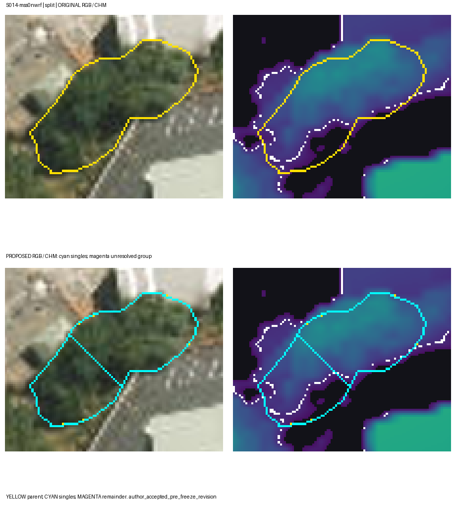

# Reference Set Freeze Review

This review assembles the evidence needed to decide whether the Auckland crown reference set can be frozen. It reports the original labels separately from the accepted pre-freeze refinement, identifies unresolved annotations and sparse strata, and preserves the blind independent comparison. **The reference set is not yet frozen.** No validation or test model predictions were used to prepare the figures or revise labels.

## Counts by split and stratum

The original export contains 492 polygons: 219 individual `tree` crowns, 228 `tree_group` regions, 41 selectively labelled `not_tree` regions and four `uncertain` regions. The 492 objects represent completed annotation work, not 492 independent tree instances. Individual-tree metrics use only the `tree` class. The 14 accepted group revisions produce a separate **pre-freeze** version with 495 active polygons: 234 individual trees, 216 groups, 41 hard negatives and four uncertain regions. The original export remains the only XZ input for the initial blind XZ/TW agreement calculation on S016 and S020.

Each cell below gives **original → accepted pre-freeze individual-tree count**. There is one site per stratum in each split.

| Stratum | Training | Validation | Test |
|---|---:|---:|---:|
| Open street trees | 25 → 26 | 17 → 17 | 33 → 34 |
| Parks and open grown | 6 → 7 | 11 → 11 | 9 → 9 |
| Dense broadleaf | 4 → 4 | 10 → 14 | 10 → 10 |
| Conifer dominant | 1 → 1 | 5 → 5 | 5 → 5 |
| Palm present | 10 → 10 | 3 → 5 | 7 → 7 |
| Small and subcanopy | 13 → 14 | 14 → 15 | 5 → 5 |
| Canopy edge | 10 → 11 | 5 → 5 | 13 → 16 |
| Hard-negative built | 1 → 1 | 1 → 1 | 1 → 1 |
| **Total** | **70 → 74** | **66 → 73** | **83 → 87** |

The accepted version adds 15 defensibly identified individual crowns, but it does not correct the thin conifer training denominator or the one-tree hard-negative sites. Test conifer and small/subcanopy strata each have five individual references. Each omission therefore changes their site recall in steps of 0.20, and a one-tree stratum has only 0 or 1 recall. These counts should be considered before deciding whether a small, targeted top-up is needed. No acceptance threshold is changed. Full machine-readable counts are in `docs/group_refinement_2026-09-18/workflow_accepted234/counts_by_split_stratum.csv`; the original 24-row counts are in `docs/review_2026-09-17/counts_by_split_stratum.csv`.

## Flagged large polygons

All 11 raw polygons above the generic 900 m² review flag are `tree_group`, with areas from 909.2 to 2,476.1 m². RGB and CHM review found connected or touching canopy within each outline, without an obvious polygon extending across unrelated background. The review supports retaining their *group* category; it does not establish their individual-tree multiplicity or independently verify every boundary. They remain outside the individual-tree denominator.

| Site | Original label ID | Area m² | Outcome |
|---|---|---:|---|
| S004 | S004-ms2pluuz | 909.2 | Retain group |
| S008 | S008-mspfkk7a | 1,476.3 | Retain group |
| S010 | S010-mspgqee9 | 1,616.9 | Retain group |
| S010 | S010-mspgrrq7 | 1,025.4 | Retain group |
| S010 | S010-mspgttd5 | 1,428.8 | Retain group |
| S011 | S011-msrzankn | 1,866.0 | Retain group |
| S011 | S011-msrzgldr | 1,154.2 | Retain group |
| S012 | S012-msrzleqc | 964.4 | Retain group |
| S012 | S012-msrzpp5k | 938.6 | Retain group |
| S015 | S015-mss171sg | 1,126.2 | Retain group |
| S021 | S021-mss2tjpn | 2,476.1 | Retain group |

The yellow boundary is the original group polygon. These source-only panels use no baseline or GPU detections. `scripts/42_build_reference_freeze_figures.py` records input and output hashes in `reference_review_figures/provenance.json`.

## Uncertain regions and selective negatives

The four original `uncertain` polygons remain unresolved: one S011 object at a crown edge and three S014 objects in deep roadside shadow. RGB and CHM do not justify promoting them to an individual tree or treating them as known background. All four retain their original geometry and label, are excluded from scored reference objects, and define ambiguity regions for the fixed scoring rule. That rule first matches eligible individual trees; only an otherwise unmatched prediction whose clipped centroid is covered by a group or uncertain region is ignored, with its identifier and count reported. `not_tree` polygons do **not** cause an ignore. This operational rule was recorded before held-out model results and remains subject to the formal protocol lock.

The 41 `not_tree` polygons are selectively chosen hard negatives, not an exhaustive map of background. They remain visible to commission-error review. Ordinary scored precision is TP/(TP+FP) over all non-ignored unmatched predictions; neither IoU nor its denominator requires a hard-negative polygon. Excluding uncertain regions does not reclassify them as negatives.

Raw browser JSON contains 39 invalid polygons repaired in the derived geospatial export using `buffer(0)`; the maximum absolute repair-area change is 0.0642 m². Seventeen objects slightly cross site boundaries, with maximum outside area 2.9873 m². Raw annotations remain unchanged; reference and prediction geometries are clipped to the same site during scoring. These technical repairs do not settle biological identity.

## Group refinement already applied to a separate version

All 228 original groups were reviewed against RGB and CHM without model detections. A group was kept whenever a repeatable individual-crown boundary could not be identified. Among 14 accepted parent-object changes, 11 compact, apparently single crowns were reclassified without changing their exterior shape. Three parent groups were divided along visually chosen boundaries, producing four individual crowns; the unresolved remainder of two parents stays a group. The other 214 original groups are unchanged. The resulting active group count is 214 unchanged plus two retained remainders = 216. Parent and child polygons are not double counted.

The split procedure is implemented in `scripts/26_refine_tree_groups.py` and checked by `scripts/27_validate_group_refinement.py`: it repairs and site-clips a parent geometry, converts manually chosen boundaries from the 0.25 m annotation grid to EPSG:2193, intersects children with the parent, keeps any unresolved remainder as `tree_group`, and checks topology, overlap, area conservation, counts and lineage. It does **not** divide groups equally, turn CHM peaks into reference trees, or produce checked three-dimensional point labels. Automated checks establish geometric consistency rather than biological correctness. The author accepted these 14 changes for a pre-freeze working version on 18 September; eight later proposed changes remain unaccepted and are excluded here.

S014 illustrates the boundary risk: the RGB suggests two adjacent lobes, while the CHM does not independently prove a distinct saddle. This image is a review aid and should be reconsidered during adjudication, especially because S014 is in validation. Accepted pre-freeze labels must not replace the original XZ labels when computing independent agreement with the supervisor's blind export.

## Freeze decision path

1. Archive the supervisor's original blind S016/S020 JSON unchanged and validate site completion, geometry, CRS and SHA-256. Compare it with the **original** XZ labels first, reporting one-to-one IoU ≥ 0.50 agreement F1, matched IoU, matched-class kappa and object-level disagreements.
2. Resolve disagreements in a separate adjudication record. Inspect the 14 accepted group changes and the four uncertainty regions against blind evidence, retaining or revising each with a reason. Keep the eight unaccepted group proposals outside the working reference unless reviewed separately.
3. Present the original and proposed split-by-stratum counts, all 11 large-group outcomes, uncertainty exclusions, selective-negative coverage and thin-stratum consequences. Decide whether a small, targeted top-up is needed. The supervisor accepted 492 polygons as annotation work; no rule requires forcing 500 individual crowns from unresolved groups.
4. Only after the top-up/adjudication decision, produce a fresh derived reference, validate repairs and class mapping, record its hash and a supervisor confirmation, then lock the evaluation policy and test split. Training-only diagnostics may guide model development before that lock; validation/test predictions must not be used to rewrite references or acceptance rules.

Current decision: **pending** the independent S016/S020 labels and explicit reference-freeze discussion. The accepted 234-tree layer is a reviewable working derivative, not the final benchmark truth.
