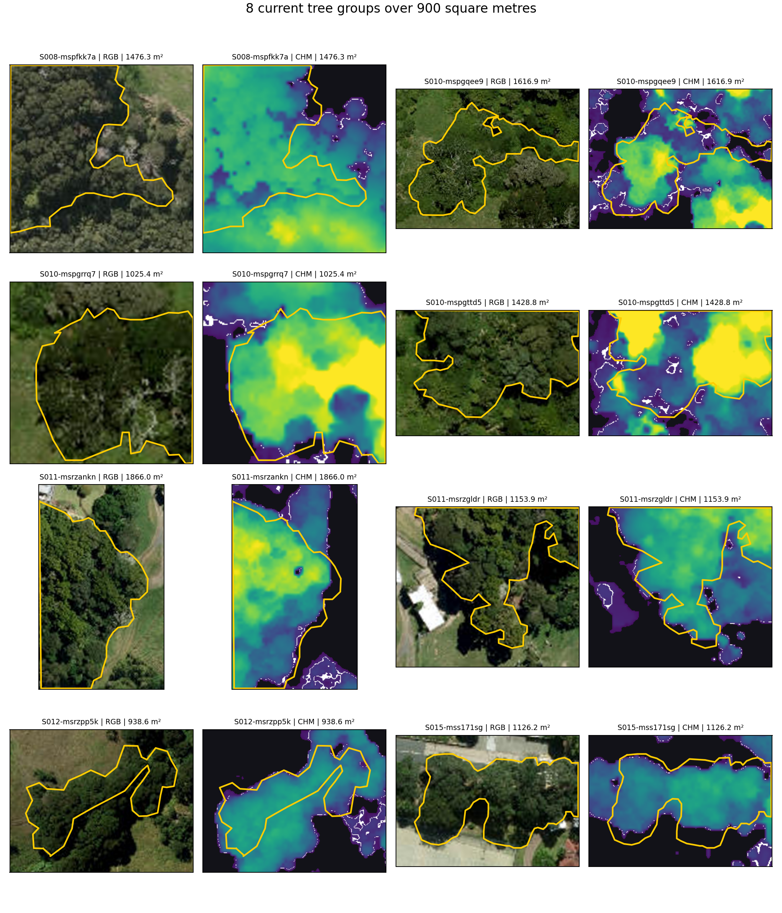
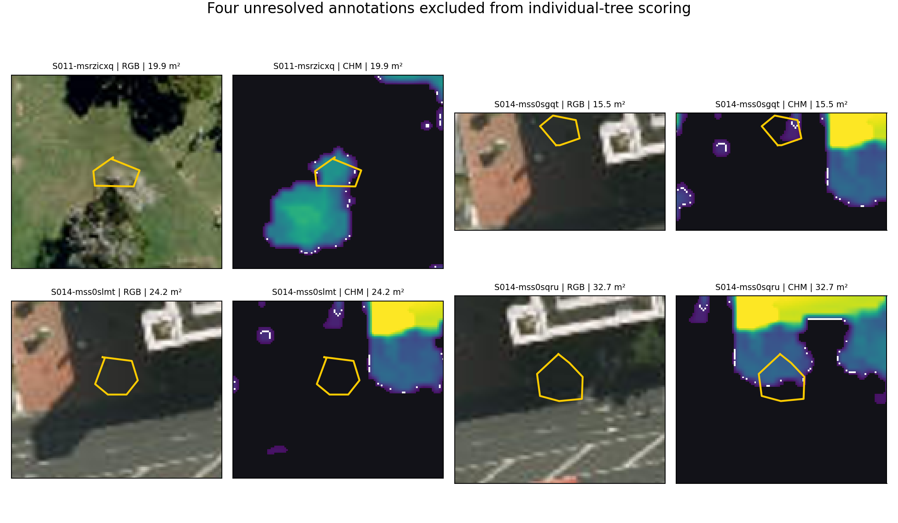
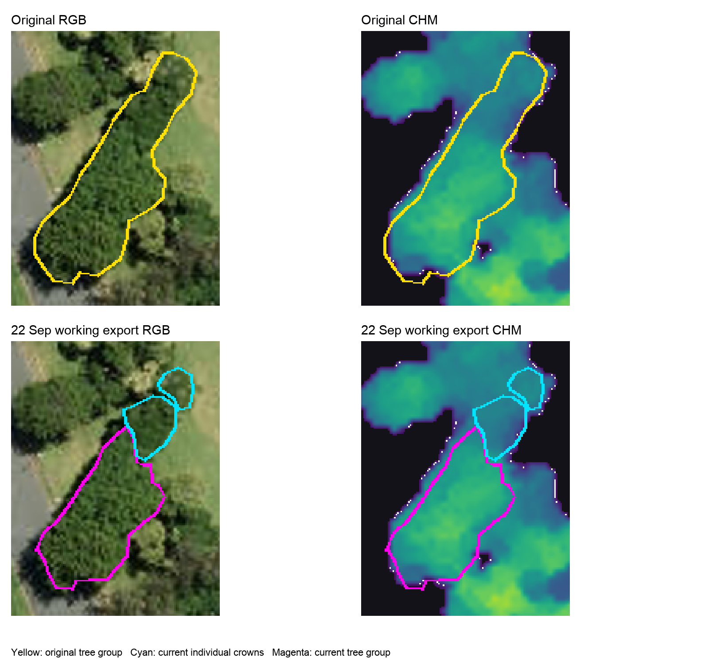

# Reference Set Freeze Review

This review assembles the evidence needed to decide whether the Auckland crown reference set can be frozen. It reports the original labels separately from the 22 September manual export, identifies unresolved annotations and sparse strata, and preserves the blind independent comparison. **The reference set is not yet frozen.** No validation or test model predictions were used to prepare the figures or revise labels.

## Counts by split and stratum

The original export contains 492 polygons: 219 individual `tree` crowns, 228 `tree_group` regions, 41 selectively labelled `not_tree` regions and four `uncertain` regions. The 492 objects represent completed annotation work, not 492 independent tree instances. Individual-tree metrics use only the `tree` class. The author's `crown_labels_XZ_2026-09-22-2.json` is the version for this **pre-freeze report**. It contains 523 active polygons: 249 individual trees, 229 groups, 41 selected non-tree regions and four uncertain regions. Its SHA-256 is `67e17c550a281e1906415fbae72e9fee9da9d6a5f2fc4de8360b041bf24796ce`. It supersedes the earlier 234- and 240-tree working drafts, but is not a formal freeze. The original export remains the only XZ input for the initial blind XZ/TW agreement calculation on S016 and S020.

Each cell below gives **original → 22 September pre-freeze report individual-tree count**. There is one site per stratum in each split.

| Stratum | Training | Validation | Test |
|---|---:|---:|---:|
| Open street trees | 25 → 27 | 17 → 17 | 33 → 34 |
| Parks and open grown | 6 → 7 | 11 → 11 | 9 → 10 |
| Dense broadleaf | 4 → 5 | 10 → 16 | 10 → 11 |
| Conifer dominant | 1 → 2 | 5 → 7 | 5 → 5 |
| Palm present | 10 → 10 | 3 → 3 | 7 → 8 |
| Small and subcanopy | 13 → 18 | 14 → 15 | 5 → 6 |
| Canopy edge | 10 → 12 | 5 → 6 | 13 → 16 |
| Hard-negative built | 1 → 1 | 1 → 1 | 1 → 1 |
| **Total** | **70 → 82** | **66 → 76** | **83 → 91** |

The next table reports `tree_group` regions. These objects document annotation coverage and define possible ignore regions under the draft scoring policy, but they do not enter the individual-tree denominator.

| Stratum | Training | Validation | Test |
|---|---:|---:|---:|
| Open street trees | 18 → 16 | 13 → 13 | 11 → 10 |
| Parks and open grown | 17 → 16 | 11 → 12 | 6 → 9 |
| Dense broadleaf | 20 → 19 | 14 → 10 | 15 → 14 |
| Conifer dominant | 10 → 9 | 15 → 17 | 7 → 7 |
| Palm present | 10 → 10 | 6 → 6 | 12 → 13 |
| Small and subcanopy | 4 → 8 | 3 → 2 | 8 → 8 |
| Canopy edge | 11 → 10 | 7 → 13 | 7 → 4 |
| Hard-negative built | 0 → 0 | 1 → 1 | 2 → 2 |
| **Total** | **90 → 88** | **70 → 74** | **68 → 67** |

The `not_tree` table describes selectively labelled hard negatives. The unchanged counts do not imply exhaustive background coverage, so these polygons support a supplementary confuser audit rather than a true-negative denominator.

| Stratum | Training | Validation | Test |
|---|---:|---:|---:|
| Open street trees | 5 → 5 | 3 → 3 | 3 → 3 |
| Parks and open grown | 0 → 0 | 0 → 0 | 0 → 0 |
| Dense broadleaf | 0 → 0 | 0 → 0 | 0 → 0 |
| Conifer dominant | 0 → 0 | 0 → 0 | 0 → 0 |
| Palm present | 0 → 0 | 1 → 1 | 0 → 0 |
| Small and subcanopy | 10 → 10 | 7 → 7 | 11 → 11 |
| Canopy edge | 0 → 0 | 0 → 0 | 1 → 1 |
| Hard-negative built | 0 → 0 | 0 → 0 | 0 → 0 |
| **Total** | **15 → 15** | **11 → 11** | **15 → 15** |

The new export has a net increase of 30 individual crowns over the original, but it does not correct the thin conifer training denominator or the one-tree hard-negative sites. Test conifers still have five individual references, so each omission changes that site's recall in steps of 0.20; a one-tree stratum has only 0 or 1 recall. The four `uncertain` regions are unchanged: three occur in the validation palm site and one in the test conifer site; none enters a scored class denominator. These counts should be considered before deciding whether a small, targeted top-up is needed. No acceptance threshold is changed. The complete four-class comparison is reproduced by `scripts/44_summarise_reference_composition.py` and stored in `docs/reference_review_counts_2026-09-22/reference_composition_by_split_stratum.csv`; its JSON receipt records the input hashes. The original 24-row tree counts remain in `docs/review_2026-09-17/counts_by_split_stratum.csv`.

## Flagged large polygons

Recalculation from `crown_labels_XZ_2026-09-22-2.json` identifies **eight current `tree_group` polygons above 900 m²**, with areas from 938.6 to 1,866.0 m². RGB and CHM review shows connected or touching canopy within each current outline, so all eight remain groups for the pre-freeze report. The original review contained 11 large groups. The original S004, S012 (`S012-msrzleqc`) and S021 IDs were retired during manual redrawing; replacement labels in those areas fall below 900 m² or are represented by smaller groups and individual crowns. Because the browser export did not store exact parent-child links, the current objects are reported directly rather than attributing automatic lineage to the retired polygons.

| Site | Current label ID | Current area m² | Outcome |
|---|---|---:|---|
| S008 | S008-mspfkk7a | 1,476.3 | Retain group |
| S010 | S010-mspgqee9 | 1,616.9 | Retain group |
| S010 | S010-mspgrrq7 | 1,025.4 | Retain group |
| S010 | S010-mspgttd5 | 1,428.8 | Retain group |
| S011 | S011-msrzankn | 1,866.0 | Retain group |
| S011 | S011-msrzgldr | 1,153.9 | Retain group |
| S012 | S012-msrzpp5k | 938.6 | Retain group |
| S015 | S015-mss171sg | 1,126.2 | Retain group |

The yellow boundary is the current group polygon in the 22 September pre-freeze export. These source-only panels use no baseline or GPU detections. `scripts/42_build_reference_freeze_figures.py` reads the named JSON directly and records its hash, the eight label IDs, image-source hashes and output hashes in `reference_review_figures/provenance.json`.

## Uncertain regions and selective negatives

The four original `uncertain` polygons remain unresolved: one S011 object at a crown edge and three S014 objects in deep roadside shadow. RGB and CHM do not justify promoting them to an individual tree or treating them as known background. All four retain their original geometry and label, are excluded from scored reference objects, and define ambiguity regions for the fixed scoring rule. That rule first matches eligible individual trees; only an otherwise unmatched prediction whose clipped centroid is covered by a group or uncertain region is ignored, with its identifier and count reported. `not_tree` polygons do **not** cause an ignore. This operational rule was recorded before held-out model results and remains subject to the formal protocol lock.

The 41 `not_tree` polygons are selectively chosen hard negatives, not an exhaustive map of background. They remain visible to commission-error review. Ordinary scored precision is TP/(TP+FP) over all non-ignored unmatched predictions; neither IoU nor its denominator requires a hard-negative polygon. Excluding uncertain regions does not reclassify them as negatives.

The new raw browser JSON has three self-intersecting polygons (`S018-mucat6cf`, `S019-mucaueb0` and `S021-mucaw3n1`). A `buffer(0)` check produces valid polygons with a maximum absolute area change of 0.0723 m². One polygon (`S017-mucar6io`) extends 0.0393 m² beyond its site boundary. The source file remains untouched; these repairs and clipping must be checked in a new derived scoring layer before formal freeze. They do not settle biological identity.

## Group refinement and later manual redrawing

All 228 original groups were reviewed against RGB and CHM without model detections. Earlier working drafts recorded 14 accepted parent-object changes and then six more. The 22 September manual export supersedes those drafts: 17 accepted whole-group reclassifications retain their label IDs, while all three earlier split child sets at S007, S014 and S017 were redrawn or replaced. Relative to the 240-tree draft, 45 IDs are new and 17 are retired across ten sites. These are editing counts, not 45 verified new trees. The resulting class totals are the 249 trees and 229 groups reported above; the earlier 14-change/234-tree description must not be used as the current denominator.

The earlier split procedure in `scripts/26_refine_tree_groups.py`, checked by `scripts/27_validate_group_refinement.py`, applies to the versioned 240-tree derivative. The latest browser export has new manually drawn IDs without exact parent-child metadata, so that prior validation receipt cannot certify the new 249-tree geometry. The new export has been audited for class counts, duplicate IDs, validity and site bounds; the three invalid raw polygons and revised boundaries still need a checked derived GPKG and object-level adjudication before freeze. Neither a CHM peak nor a previously accepted split automatically verifies the number of current individual trees. The two declined second-round suggestions remain outside the latest active JSON, with their historical comparison panels retained separately.

S007 illustrates the change in version: one original group boundary is now represented in the same area by a retained group and two individual-crown outlines. The figure shows spatial correspondence, not an exact stored parent-child lineage or independent stem confirmation. In S014, the prior two-tree split has been replaced by a group in the latest export; that former image remains a historical review aid, not the current reference. The original XZ labels must still be used for independent agreement with the supervisor's blind export.

## Freeze decision path

1. Archive the supervisor's original blind S016/S020 JSON unchanged and validate site completion, geometry, CRS and SHA-256. Compare it with the **original** XZ labels first, reporting one-to-one IoU ≥ 0.50 agreement F1, matched IoU, matched-class kappa and object-level disagreements.
2. Resolve disagreements in a separate adjudication record. Inspect the latest redrawn objects, the three invalid geometries, the four uncertainty regions and any proposed parent-child mapping against blind evidence, retaining or revising each with a reason. Keep the two declined earlier suggestions outside the working reference unless a new, explicitly recorded review changes that decision.
3. Present the original and proposed split-by-stratum counts, the eight current large groups together with the three retired original flags, uncertainty exclusions, selective-negative coverage and thin-stratum consequences. Decide whether a small, targeted top-up is needed. The supervisor accepted 492 polygons as annotation work; no rule requires forcing 500 individual crowns from unresolved groups.
4. Only after the top-up/adjudication decision, produce a fresh derived reference, validate repairs and class mapping, record its hash and a supervisor confirmation, then lock the evaluation policy and test split. Training-only diagnostics may guide model development before that lock; validation/test predictions must not be used to rewrite references or acceptance rules.

Current decision: **pending** the independent S016/S020 labels, geometric adjudication and explicit reference-freeze discussion. The 249-tree layer is the author's version for this pre-freeze report, not the final benchmark truth.
