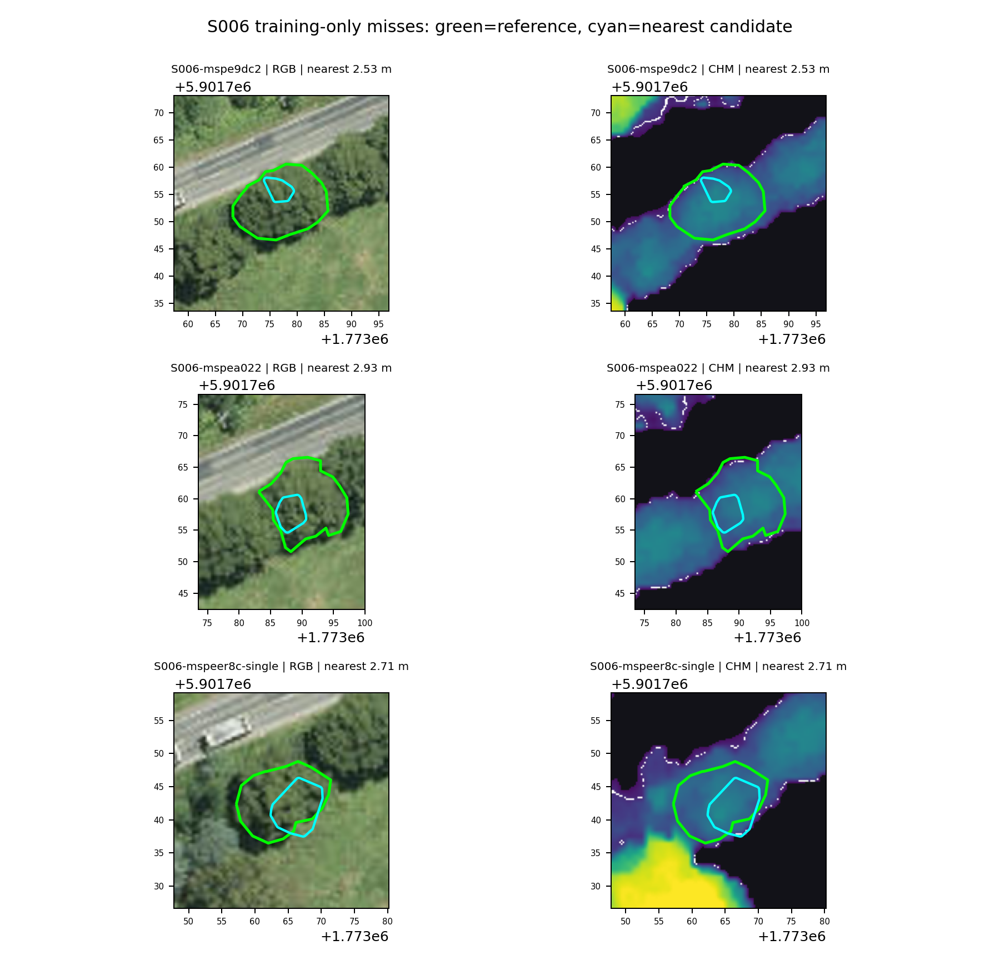
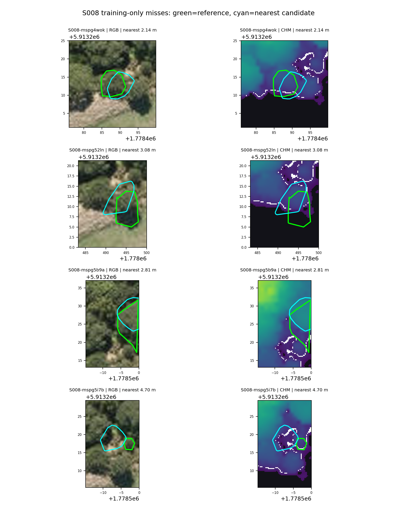

# Training-site unmatched-crown audit

This audit describes the seven individual reference crowns missed by the provisional 0.5 m convex-hull point-instance conversion at S006 and S008. Both sites are in the training split. It uses the accepted 234-tree **pre-freeze** working derivative and the same 2 m centroid rule already recorded for development scoring. No reference label, prediction, matching tolerance, or acceptance threshold was changed. These values are not held-out benchmark results.

| Site | Missed reference IDs | Nearest candidate-centroid distances | Point-instance support |
|---|---:|---:|---|
| S006 | 3 | 2.534–2.926 m | Positive instance points occur inside all three reference crowns. |
| S008 | 4 | 2.144–4.697 m | Positive instance points occur within 2 m of all four crowns; one has none inside its outline. |

Every missed crown has a nearest candidate polygon, but none has a candidate centroid within the fixed 2 m tolerance. Nearest-polygon IoU ranges from 0.094 to 0.332 at S006 and 0.003 to 0.464 at S008. This locates the immediate **scoring failure** at the candidate polygon position/shape relative to the current crown reference. It does not prove that the point model found the correct biological tree, nor does it justify widening the tolerance after inspecting these results. The visual evidence suggests small or displaced instance hulls at several crowns and ambiguous separation at dense canopy edges; those remain qualitative observations.

Green outlines are accepted pre-freeze individual reference crowns; cyan outlines are the nearest 0.5 m candidate polygons. The seven object-level distances, IoUs and point counts are in `S006/misses.csv` and `S008/misses.csv`. The `provenance.json` files bind the exact reference, predictions, evaluation, point-support CSV and chips by SHA-256. The local run IDs are `20260921T2200Z_S006_miss_audit` and `20260921T2201Z_S008_miss_audit`; the complete source point/polygon archives are retained outside Git. The audit can be repeated with `scripts/43_audit_training_misses.py` and the archived inputs.

The separate scored-false-positive audit found 26 S006 and 16 S008 scored false positives. Neither site has a selectively annotated `not_tree` polygon, so there is no explicit-hard-negative overlap to assess there. These counts are ordinary development FP counts, not an exhaustive negative-landscape audit.
